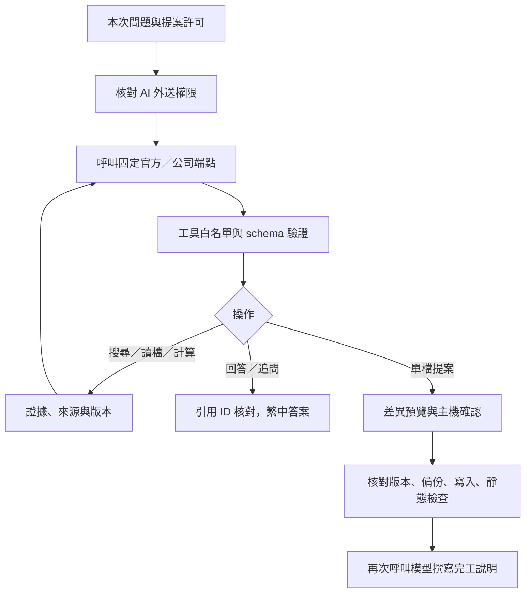

# OpenAI 與公司 AI 連線操作

## 一、啟動 AI 服務

說明本機啟動、API key 與初次連線流程。

先停止舊的 4317 服務，在 PowerShell 執行：

```powershell
Set-Location C:\Web_Practice\ReAct\code_and_document_assistant
.\start_ai.ps1
```

腳本詢問 API key（隱藏輸入）及帳號可用的 API 模型 ID。請填實際 API ID，不要猜測介面顯示名稱。key 只存在此次程序環境，結束會恢復原設定；腳本不安裝 npm。預設 localhost，瀏覽器開啟 `http://127.0.0.1:4317/`，終端會顯示本機管理碼。

`CDA` 是 Code & Document Assistant 的縮寫；`CDA_*` 環境變數是本專案使用的設定前綴。

`CDA_PROJECTS_CONFIG` 指定本專案的專案設定檔位置。

若組織政策不允許執行 PowerShell 腳本，可使用組織核准方式設定環境 `CDA_MODEL_MODE=real`、`CDA_AI_MODEL`、`CDA_AI_KEY` 再執行 `node server.js`。不要把真實 key 寫入命令歷史、BAT、JSON、前端或 Git。

1. 頂部＋開啟授權視窗，填入本次管理碼。
2. 按「測試 AI 連線」。只送固定文字，會使用 API 額度；不送專案內容。通過才表示此次端點與工具格式成功驗證。
3. 為專案／全域參考勾選「允許內容送往目前設定的 AI」並確認授權。
4. 開啟目標專案，更新索引；在對話中提問，或用 @file 限定檔案。
5. 若要修改或新增，選「AI 修改程式」，送出需求。在中央工作台預覽；修改確認後備份並寫入，新檔則逐份確認建立或略過，依授權執行靜態檢查。

AI 提案使用「AI 修改程式」入口；「人工編輯／靜態驗證」是人工編輯器。切換專案會清除 AI 提案許可。

### 修改介面更新

連線完成後，可直接選「AI 修改程式」，自動勾選提出單檔修改。中央工作台呈現差異、確認套用、驗證與 API 回報 token；「人工編輯／靜態驗證」供手動填入候選程式。詳見 [工作台流程](task_workbench_flow.md)。

### 一鍵啟動 Luna（僅本機）

- 雙擊 `start_ai_luna_local.bat`，或在終端執行：
  ```powershell
  & 'C:\Web_Practice\ReAct\code_and_document_assistant\start_ai_luna_local.bat'
  ```
- 腳本會檢查 4317、啟動 `start_ai.ps1 -Model gpt-5.6-luna`、要求本次使用的 API key，並在服務就緒後開啟 `http://127.0.0.1:4317/`。
- 此檔案不啟用 LAN IP，也不保存 key；按該視窗的 `Ctrl+C` 停止服務。

## 二、公司 URL、認證與模型

說明官方端點、公司閘道與模型設定方式。

常見流程是「助手後端 → 公司 AI 閘道 URL → 公司配置的模型」。是否需要 model、格式是否相容，須依公司規格確認。

複製 `config/ai.company.example.json` 為 `config/ai.local.json`，修改非機密設定。後者已加入 gitignore；key 仍不放此檔。

```json
{
  "provider": "openai-compatible",
  "protocol": "chat-completions",
  "endpoint": "https://your-approved-gateway.example/v1/chat/completions",
  "model": "company-model-alias",
  "omitModel": false,
  "keyEnvironmentVariable": "CDA_COMPANY_AI_KEY",
  "authHeader": "Authorization",
  "authPrefix": "Bearer ",
  "toolMode": "native"
}
```

```powershell
.\start_ai.ps1 -Config .\config\ai.local.json
```

- 公司規格與設定方式：
  - Responses 相容：`protocol` 設為 `responses`，填入完整 `endpoint`。
  - Chat Completions 相容：`protocol` 設為 `chat-completions`，填入完整 `endpoint`。
  - URL 固定模型、不接受 `model`：`omitModel` 設為 `true`。
  - 公司模型／部署別名：`model` 填入公司提供的原值。
  - Authorization: Bearer：維持範例的 `authHeader` 與 `authPrefix`。
  - api-key 標頭：`authHeader` 設為 `api-key`，`authPrefix` 設為空字串。
  - Chat 沒有原生工具呼叫：經確認後將 `toolMode` 設為 `json`；後端仍會驗證同一套工具 schema。
  - 其他 payload、簽章、SSO 或原生 Claude 格式：提供去機密的請求／回應範例，另行實作 adapter；不能只更換 URL。

endpoint 不會自動補 `/v1`，可含非機密版本參數；不得含 key／token、使用者密碼或 fragment。使用 HTTPS；只有 localhost 測試允許 HTTP。禁止自動重新導向，不停用 TLS 驗證。公司 CA 需由組織提供核准的 Node 信任設定。

Responses 送 `max_output_tokens`；Chat 送 `max_completion_tokens`，皆使用 `store:false`。公司閘道若不支援這些欄位、strict tools 或回傳格式，需依實際文件調整。JSON 模式只替代工具呼叫格式，仍使用 Chat messages；不是任意 API 相容層。

`CDA_AI_CONFIG` 指定 JSON 路徑，`CDA_AI_MODEL` 可覆寫模型。沒有設定檔時預設官方 OpenAI Responses，但必須提供模型與 key；缺設定顯示 CONFIG_REQUIRED，不回退 Mock。

## 三、檔案外送權限

說明檔案範圍、授權檢查與版本核對。

- 只有範圍內且允許 AI 外送的檔案才列給模型；初始只列相對名稱、ID、版本，原文在搜尋／讀檔時提供。
- 選取未授權的 @file 會在模型呼叫前拒絕。未指定檔案時，只提供可外送的範圍；無檔案時仍可送出使用者問題，但不能假裝已閱讀專案。
- 全域 AI 授權不可繞過更具體子專案的 AI 禁止或到期；A 若已單獨登錄，亦需有效 AI 許可。
- 每輪與每次重試重查授權，已取得原文核對版本；撤銷停止後續外送，已發送請求無法回收。
- 模型沒有任意 SQL、shell、網址、授權或套用工具；可提出目前目標內既有程式檔修改，或最多 20 份待逐檔確認的新程式檔。
- 本版每次只送本次問題、選取圖片與授權檔案；歷史對話只供介面查看，尚不自動送入多輪上下文。

## 四、圖片能力與創作流程

說明圖片輸入、圖片創作與逐版保存方式。

- 圖片輸入
  - 依官方 [Images and vision](https://developers.openai.com/api/docs/guides/images-vision) 接入：Responses 使用 `input_image`，Chat 使用 `image_url`。
  - 圖片以 Base64 data URL 傳送，不上傳到 OpenAI Files API。
  - 程式在未明確提供 `supportsImages` 時，只有 `provider: "openai"` 且完整模型 ID 為 `gpt-5.6-luna` 才預設啟用；`start_ai.ps1 -Model gpt-5.6-luna` 可沿用。
  - 若 AI JSON 明確設為 `false`，仍以主機設定為準；其他模型、公司別名或 URL 固定模型必須依端點能力明確設定 `"supportsImages": true` 或 `false`。公司範例預設為 `false`，不由名稱猜測。
  - 未啟用圖片能力時，前端與後端都阻止帶圖送出，草稿仍保留。
  - 啟用圖片能力只是主機設定聲明，不等於已驗證公司端點的費用或實際支援；端點拒絕含圖請求時保留錯誤，不回退只送文字。
  - 每輪與重試都重新核對目前專案的 AI 外送權限；圖片只作為本次模型輸入，不自動建立專案圖片檔。
- 圖片創作
  - 與圖片輸入分開，使用官方 OpenAI Images API；主機必須在 AI JSON 明確填入組織核准且帳號可用的 `"imageGenerationModel"`，例如 `"gpt-image-1"`。
  - 範例設定預設空字串（停用）；API key 由 `CDA_AI_KEY` 提供，不放在 JSON。
  - 公司 OpenAI 相容端點尚未接入圖片創作，不會自動退回其他模型；模型可用性、額度與費用需用實際帳號確認。
  - 在對話框整理提示詞後，送出明確的圖片創作需求只會先開啟確認窗；也可從輸入框的「＋」選單點「創作圖片」。
  - 確認窗顯示版本與完整提示詞；「返回修改」不消耗圖片 API 請求，未設定圖片模型時「開始創作」停用。
  - 確認後圖片顯示在目前對話時間線；點「修改這張圖片」輸入下一輪要求，再次確認後產生下一版，可下載每版 PNG。
  - 版本檔名取自任務主題；PNG 與同名 JSON 存於 `runtime/assistant-state/generated-images/<projectId>/<conversationId>/<seriesId>/`，時間線紀錄存於 `runtime/assistant-state/state.json`。
  - 服務重啟後可查看已完成版本，未完成的產圖不會自動續跑；每次圖片創作都要求目前專案已有 AI 外送授權。

## 五、執行流程與限制

說明模型回合、工具白名單、錯誤與用量限制。



- 一般問答與回答保存：
  - `finish.answer` 顯示於任務卡片第一層，保留完整 Markdown、段落、條列與程式碼。
  - 結論、依據、推論、未確認事項與工具紀錄保存在「詳細資訊」。
  - 舊任務沒有 `answer` 時，沿用原本的結論摘要；回答與完工說明會隨對話保存，重新載入後仍可查看。
- 修改與完工說明：
  - AI 修改提案尚待確認時，不會宣稱已完成。
  - 確認套用並完成靜態驗證後，另外呼叫一次模型，提供實際操作狀態、提案摘要與精簡驗證結果來撰寫完工說明。
  - 驗證失敗照實回報；新增檔案提案則在最後一份完成確認或略過後撰寫。
  - 補述會額外使用 API 額度，呼叫前會重新核對 AI 外送權限。
  - 模型補述失敗不影響已完成的寫入或驗證，改顯示固定的事實摘要；人工修改與 Mock 流程不呼叫模型補述。
- 請求與工具限制：
  - 預設每次請求 30 秒、整體 120 秒、最多 8 輪／12 次工具，每輪一個工具。
  - 429、5xx、網路失敗或逾時最多重試一次；401 與格式錯誤不盲目重試；取消會中止 HTTP。
  - 輸出上限 4096 token；單檔原文 32 KiB、文字上下文 256 KiB、API 回應 1 MiB。
  - 圖片另依前端設定限制每張 1–20 MB、最多 5 張，並以同一批圖片帶入本次任務的模型輪次。
- 達到限制時：
  - 保留已取得的證據並回傳部分完成原因。
  - 既有檔案仍為單檔修改；新增最多 20 份程式檔，需每份確認。
  - 不建立資料夾或執行使用者程式；數值工具只提供浮點加減乘除，不保證財務精度。
- 核對與錯誤：
  - 模型依指示核對對象、日期、單位與條件；程式核對引用 ID、來源與版本。
  - 尚無獨立語意審查器，不能保證模型每句結論都受來源支持。
  - 拒絕、截斷、未知工具、格式錯誤或無效引用會回報部分完成。
- 用量與公開紀錄：
  - 任務保留實際回傳的 input/output token；缺少時為 `null`。
  - 成本為 `null`，不把估算值當成實測；失敗請求仍可能產生供應商費用。
  - 公開工具摘要顯示請求次數、耗時與錯誤類型，不展示原始 API 錯誤本文、認證標頭或模型內部思考。

## 六、程式與驗收

說明目前實作摘要、故障排查與測試檔案。

### 目前實作摘要（2026-09-16）

- 已實作官方 OpenAI Responses，以及公司 OpenAI 相容 Responses／Chat Completions。
- 公司 URL 可以是模型閘道；`model` 可填公司別名，或由 URL 固定指定。
- API key 只由後端環境讀取，JSON 設定不接受 key 值。
- 支援受控搜尋、讀檔、基本計算、單檔修改、新檔逐份確認與答案引用；圖片輸入設定見「圖片能力與創作流程」。
- 已用假 key、假模型及 Chrome 實測；尚未驗證使用者的官方帳號或公司端點。
- 真實 SQL／內部 API 未接入；real 模式不使用 Mock 訂單結果。

### 連線故障排查（2026-09-16 更新）

服務執行中，另外開 PowerShell 做檢查。`Test-NetConnection api.openai.com -Port 443` 通過只代表 TCP 可達；不代表 key 或模型已驗證。

```powershell
curl.exe -sS -o NUL -w "HTTP %{http_code}`n" -X POST https://api.openai.com/v1/responses -H "Content-Type: application/json" -d "{}"
```

這個不帶 key 的測試收到 `401` 屬正常。若網頁仍報錯，先依錯誤類型處理：

- 錯誤訊息與處理方式：
  - `AI_KEY_FORMAT`：重輸原始 key；不包含空白、中文、引號或 Bearer 前綴。
  - `AI_HTTP_401`：端點已回應；確認 key 有效及所屬專案權限。
  - `AI_HTTP_400／404`：核對模型、endpoint 與請求協定。
  - `AI_HTTP_429`：檢查 API 額度與頻率限制；此狀態未細分原因。
  - `AI_NETWORK + DNS` 代碼：檢查服務行程的 DNS／網路環境。
  - `AI_NETWORK + TLS` 代碼：檢查 Node.js 信任憑證或公司 HTTPS Proxy；不要停用 TLS 驗證。
  - `AI_NETWORK + 連線逾時／重設` 代碼：檢查路由、Proxy、防火牆或暫時網路故障。

網路診斷僅顯示白名單代碼及固定描述，不顯示原始錯誤本文、key 或標頭。更新程式後，停止舊服務並重新執行 `start_ai.ps1` 才會載入新版；依提示重輸 key，重新整理頁面後測試。既有外部資料夾需重新授權。這次診斷未使用使用者 key，不代表付費模型呼叫成功。

- 相關檔案與作用：
  - `start_ai.ps1`：隱藏 key 輸入、本次環境及 localhost 啟動。
  - `src/ai-config.js`：設定驗證、固定 endpoint、key 環境變數。
  - `src/ai-client.js`：Responses／Chat、認證、逾時重試與格式轉換。
  - `src/ai-agent.js`：AI 權限、schema、受控工具、引用與版本。
  - `tests/ai.test.js`：假模型協定、權限、修改、錯誤、逾時、取消。
  - `tests/ai-browser-smoke.js`：假模型 real 模式前端完整驗收。

依 [OpenAI Function calling](https://developers.openai.com/api/docs/guides/function-calling) 與 [Chat Completions](https://developers.openai.com/api/reference/resources/chat/subresources/completions/methods/create) 官方文件實作。真實 OpenAI key／公司端點未在本次測試中使用；結果摘要見 [version_history.md](version_history.md)，完整歷史報告見 [archive/test_report.md](archive/test_report.md)。


