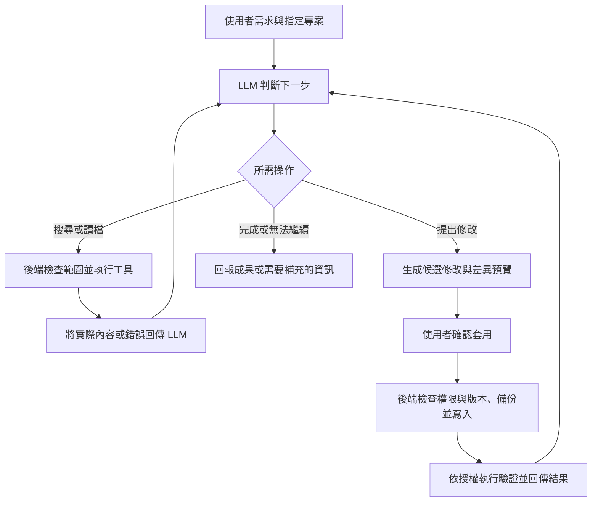

# LLM 如何搜尋專案並修改檔案

2026-09-16：真實 AI adapter 與受控搜尋／讀檔／計算／單檔提案循環已實作，以假模型驗收通過。下方未接入描述為先前設計背景；最新設定、外送權限及限制見 [AI 連線流程](../../ai_connection_flow.md)。官方帳號與公司端點仍待實際連線驗收。

更新日期：2026-09-15。本文區分目前實作與未來接入 LLM 後需要補上的流程。

## Get-Content、PowerShell 與 src 是什麼？

PowerShell 是命令列 Shell 與指令碼語言，可輸入指令操作檔案、啟動程式及進行系統管理。Windows 通常內建 Windows PowerShell；另外安裝的 PowerShell 7 是不同版本，也支援其他作業系統。

`Get-Content` 是 PowerShell 內建的命令（cmdlet），用來讀取內容。例如在本助手資料夾執行：

```powershell
Get-Content -LiteralPath .\public\app.js
```

這會讀取並輸出 `public/app.js` 的文字，不會修改它。它不是 JavaScript 函式，也不是所有命令列環境都能直接使用的指令；例如在 cmd.exe 中不能直接當作 CMD 指令使用。

Node.js 也能透過自己的檔案 API 讀檔，不必呼叫 PowerShell：

```js
const fs = require('node:fs/promises');
const content = await fs.readFile('./public/app.js', 'utf8');
```

上述 JavaScript 片段需放在 async 函式中；相對路徑以 Node.js 程序的工作目錄為準。

`src` 是 source 的常見縮寫，通常指放置原始碼（source code）的資料夾。`src/` 最後的斜線表示資料夾，是命名慣例，不是特殊語法，也不會自動賦予程式能力。本專案的 `src/` 放置後端模組，例如 `engine.js`、`workspace.js`；瀏覽器端的程式則放在 `public/`。

## 圖片中的操作如何發生？

畫面上的「已執行 Get-Content」「已讀取」「已編輯」是工具操作紀錄。LLM 決定要做什麼，後端工具實際執行，再把結果交回模型；模型本身不能直接存取硬碟。介面應依實際執行結果顯示紀錄，不能只根據模型說「已修改」就標示成功。

例如需求是「幫指定專案的登入頁加入顯示密碼功能」，目前 real 流程可在受控範圍內執行搜尋、讀檔與單檔提案；多檔、任意新檔與功能測試仍有限制。



例如先搜尋登入相關檔案，再讀取 HTML 與 JavaScript，根據內容提出修改，套用後檢查。檢查失敗時，模型可依錯誤提出下一次修改；後端仍須限制輪數、工具呼叫數與執行時間。

## 本專案目前做到哪裡？

- 指定目標、唯讀參考與操作範圍：已實作於 `src/project-scope.js` 與 `server.js`。
- 搜尋與讀取授權檔案：已實作於 `src/workspace.js`。
- 人工修改提案、確認套用、備份與靜態驗證：已實作，一次處理一份現有檔案。
- 需求理解與規劃：Mock 使用 `src/model.js` 的關鍵字與固定規則；real 使用 AI adapter。
- 真實模型連線：`src/ai-client.js` 支援 Responses／Chat；缺設定時回報未設定錯誤。
- 根據內容生成修改：real 可產生既有單檔候選，主機確認後才套用；Mock 仍為固定範例。
- 根據工具結果反覆規劃：`src/ai-agent.js` 使用有限輪數工具循環，每輪重驗外送權限。

## 先前的接入工作清單（本次已實作主要連線與單檔循環）

1. 實作真實模型連線與回傳解析，接收模型選擇的工具及參數。
2. 將既有搜尋、讀檔、提案與驗證能力包成模型可呼叫的受控工具，定義參數與結果格式；Mock 訂單工具與 real 檔案工具分開。
3. 在引擎加入「模型選擇操作 → 後端檢查並執行 → 回傳結果 → 模型再判斷」的循環。
4. 加入依真實檔案內容生成修改的能力，沿用現有差異預覽、確認套用、版本檢查與專案隔離機制。
5. 將真實操作的開始、成功、失敗與差異資料送到介面，顯示可核對的執行紀錄。

本次已分流 Mock 固定分支與 real 工具循環；real 可生成單檔修改提案，發送前檢查 AI 權限，寫入仍經主機確認。待補為任意新檔、多檔修改、模型歷史上下文、實際端點驗收與一般功能測試。

## 相關文件

- [專案載入流程](../../project_workspace_flow.md)：專案登錄、索引、查詢及現有人工修改流程。
- [授權確認流程](authorization-confirmation-flow.md)：管理碼、權限與套用檢查。
- [版本與驗收摘要](../../version_history.md)：整體進度與尚缺的連線設定；原階段指南保留於 [phase_guide.md](phase_guide.md)。
- [使用說明](../../README.md)：啟動與日常操作。

