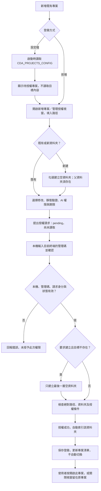
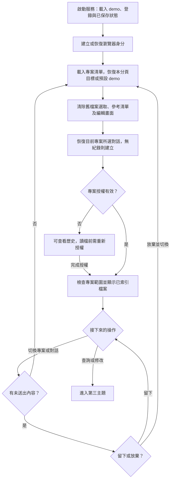
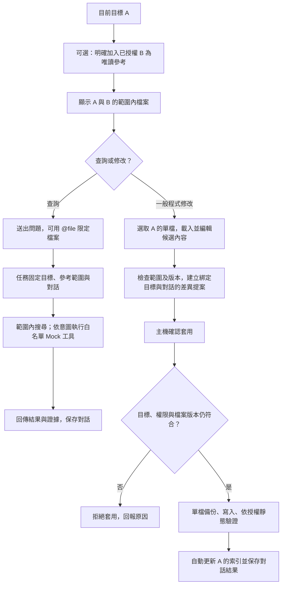

# 專案載入流程

## 雙層授權更新（2026-09-16）

新增「全域唯讀參考根目錄」類型：可授權 `C:\Web_Practice\ReAct`，子專案與其 demo 預設可搜尋；再為目前目標專案獨立授權寫入。兩層可重疊，同一路徑去重；一般專案彼此重疊仍拒絕。全域授權不會切換目標或建立專案對話。助手、runtime、備份與依賴等排除。完整操作及限制見封存的 [雙層授權流程](archive/dual_layer_authorization_flow.md)。

以下三主題中的「明確加入 B」仍適用全域範圍外的個別參考；有效的全域參考會自動加入新任務。重啟後兩層均需重新授權。

更新日期：2026-09-15。本文件依目前實作分為三個主題：

前端對應入口：左側「新增專案／管理授權」視窗、可收折的專案／對話清單，以及中央「查詢文件／修改程式」。中央頂部持續顯示目標與唯讀參考；Mock 情境與 Select2 集中在預設收合的「展示與測試」。

- 首次登錄與授權：記住專案位置，再核准讀取與操作範圍。
- 日常載入、切換與對話恢復：選擇目前專案，恢復自己的對話與檔案清單。
- 跨專案參考、查詢與修改：A 是唯一修改目標，明確加入的 B 只能唯讀參考。

## 一、首次登錄與授權

### 新版側欄與快速重新授權

- 頂部＋開啟新增專案／管理授權；標題箭頭收折整個清單。
- 專案列除「＋」重新授權與「⋯」管理外，點前方箭頭、資料夾、名稱、倒數或列內空白處都會展開／收合對話；點名稱時也會切換修改目標。首次預設收合，重新整理保留本分頁展開狀態。
- 展開後第一列「＋ 新對話」建立該專案對話，歷史依最近活動由新到舊排列。
- 每一筆歷史對話尾端有垃圾桶圖示；點擊後需確認，系統只刪除目前瀏覽器身分、該專案的對話。若刪除正在執行或等待套用的對話，會取消其任務且不讓背景保存把對話重新建立。
- 專案旁＋快速重新授權／延長：自動帶入路徑、上次權限與分鐘數，只需本次管理碼。確認後保持原修改目標。
- 非展示專案列在名稱後直接顯示剩餘時間：一小時以上只顯示整小時（例如 `2 hrs`），一小時以下只顯示分鐘（例如 `47 mins`）。專案列 hover／鍵盤聚焦覆蓋展開按鈕、名稱、＋與⋯，才顯示＋與⋯。⋯顯示完整路徑、倒數，並提供重新授權、撤銷及更新該專案索引。撤銷需本分頁已有本次管理碼，可在完整授權視窗輸入。
- 側欄展開寬度為 290px。倒數每 5 分鐘更新，另於到期時更新。背景分頁返回時重新核對；後端每次存取仍檢查期限。標題收合圖示使用 `fi-br-angle-small-down`／`fi-br-angle-small-right` 切換；專案名稱圖示依對話狀態使用 `fi-rc-folder-open`／`fi-rc-folder`。
- 到期標示「已到期」並隱藏檔案，保留對話與候選內容；重新授權後重新載入編輯檔案。

專案 `grantDefaults` 保存於 `runtime/assistant-state/state.json`，不含管理碼；重啟只恢復預填設定，不恢復權限。舊登錄缺設定採唯讀 60 分鐘，需修改時先在完整授權視窗設定。demo 使用固定權限。

實作：`public/sidebar.js` 管理清單與倒數；`public/sidebar.css` 管理外觀。圖示使用 Flaticon UIcons CDN 的 regular-chubby 與 bold-rounded 樣式，保留指定的 `fi` class。服務 CSP 僅允許該 CDN 提供樣式與字型。

登錄只記住專案位置；授權才允許讀取資料夾。前端授權成功後會自動保存登錄，但不會自動切換目前修改目標。

### 操作重點

1. 雙擊 `code_and_document_assistant_auto_ip.bat`，使用本機頁面 `http://127.0.0.1:4317/`。
2. 按左側「新增專案／管理授權」，在視窗內「指定新資料夾與權限」輸入主機絕對路徑，例如 `C:\Work\project_a`，不是檔案路徑或瀏覽器上傳。新專案根資料夾尚不存在時，勾選「路徑不存在時建立新的空資料夾」；父資料夾必須已存在，且只建立最後一層，不覆寫任何既有資料夾。
3. 按「提出授權請求」，輸入終端本次產生的 6 碼十六進位管理碼，再按「主機端確認授權」。
4. 成功後按「開啟此專案」才切換，也可關閉視窗，稍後點左側專案名稱。首次索引已自動執行，不必再按更新才能載入。

設定檔格式見 `config/projects.example.json`；它不自動授權。外部專案授權到期或服務重啟後需重新確認，登錄仍保留。兩個一般專案的父子根目錄重疊時，ProjectScope 會拒絕操作；全域唯讀根目錄與子專案則允許重疊。

### 檔案與函式

- 檔案：`server.js`
  - 函式／路由：`createApp()`、`persistProjects()`
  - 作用：載入設定、保存專案 ID／名稱／路徑
- 檔案：`public/app.js`
  - 函式／路由：`#request-root.onclick`、`#approve-root.onclick`
  - 作用：送出路徑、建立選項、權限與確認請求
- 檔案：`server.js`
  - 函式／路由：`POST /api/roots/request`、`POST /api/roots/:id/approve`
  - 作用：建立 pending 請求，檢查本機、管理碼與請求身分
- 檔案：`src/workspace.js`
  - 函式／路由：`createDirectory()`、`authorize()`、`update([root.id])`
  - 作用：受控建立最後一層空資料夾，再授權並索引該範圍

## 二、日常載入、切換與對話恢復

點專案列的箭頭、資料夾、名稱、倒數或空白處都可展開／收合對話；點名稱同時切換修改目標，不取消任務。只有「＋」重新授權與「⋯」管理不會切換展開狀態。點對話項目可恢復該紀錄，「新對話」才另建。有未送出問題或候選修改時，先選「留下繼續編輯」或「放棄並切換」；確認切換後才清除舊檔案選取與編輯畫面。

### 保存與更新規則

- 目前目標與最後選取的對話 ID 使用分頁 `sessionStorage`，不同分頁可操作不同專案。
- 登錄、瀏覽器身分及歷史對話保存在 `runtime/assistant-state/state.json`。同一身分可在重啟後查看歷史，舊修改提案不恢復執行能力。
- 身分 cookie 有效 30 天並於載入時續期；清除 cookie 或換瀏覽器／主機網址，不會自動取得原身分的對話。
- 切換不會把背景任務改成新專案，也不自動取消原任務；返回原專案可查看結果。服務重啟則不會續跑舊任務。
- 外部編輯器新增、修改或刪除檔案後，按「更新文件索引」；範圍是目前目標、明確加入的個別參考專案及所有有效全域參考。

### 檔案與函式

- 檔案：`src/app-state.js`
  - 函式／路由：`init()`、`conversation()`、`record()`、`save()`
  - 作用：載入與保存登錄、身分及歷史結果
- 檔案：`server.js`
  - 函式／路由：`GET /api/session`、`GET /api/catalog`
  - 作用：恢復瀏覽器身分、提供專案清單
- 檔案：`public/app.js`
  - 函式／路由：`switchProject()`、`clearTaskView()`、`loadConversation()`
  - 作用：切換、清除舊畫面、恢復對話
- 檔案：`public/app.js`
  - 函式／路由：`allowSwitch()`、`hasDraft()`、`renderProjectList()`
  - 作用：未送出內容提示、可收折專案／對話清單
- 檔案：`server.js`
  - 函式／路由：`GET /api/conversation-list`
  - 作用：僅列此身分在指定專案的對話，不建立或切換對話
- 檔案：`server.js`
  - 函式／路由：`GET /api/conversations`、`POST /api/conversations`
  - 作用：按身分與專案讀取或新增對話
- 檔案：`public/app.js`
  - 函式／路由：`inventory()`、`renderFiles()`
  - 作用：顯示範圍內檔案、專案名稱及完整路徑

## 三、跨專案參考、查詢與修改

先點 A 作為目標。中央頂部「加入參考」開啟唯讀勾選視窗，也可輸入 `@project` 後點選 B 選項。頂部 B 標籤的 × 可移除參考；左側收合後仍看得到目標與參考。單純輸入文字不會增加權限，修改 B 必須切換目標。

### 操作與限制

1. 查詢可直接送出問題，或勾選檔案／用 `@file` 指定來源。B 可讀取搜尋；未加入的 C 不進入本任務搜尋。
2. 選「修改程式」才顯示「實際程式檔案修改與驗證」。載入 A 的一份檔案，編輯後按「產生差異提案」，右側自動展開供確認。管理碼仍在授權視窗填入；API 也會拒絕修改或驗證參考專案。
3. 「僅靜態驗證」檢查磁碟上已索引的版本，並非尚未套用的候選內容；不代表功能測試通過。
4. 空白 JS / CJS / MJS / Python / HTML / CSS / JSON 是「空白初始檔」：可選取、載入與建立第一份內容，但不會進入搜尋或作為證據；空白文件維持未索引提示。
5. 外部修改造成 hash 不一致時，重新索引、載入及規劃，不覆蓋舊差異。套用成功後已自動更新目標索引。
6. 目前還原只針對單檔；整案版本、成果收藏尚待後續實作。一般修改內容由使用者提供，AI 仍為 Mock，對話保存不代表真實 AI 多輪推理。

一般查詢不自動展開右側；按答案中的「查看來源」或證據 ID 才展開。查詢／修改模式切換只改變顯示，保留兩邊尚未送出的內容。

文件與工具回傳均視為資料，不能擴大權限。任務建立後保留當時的參考清單；之後增減畫面參考只影響新任務，若要停止舊任務需取消。

### 檔案與函式

- 檔案：`public/app.js`
  - 函式／路由：`setReferences()`、`question.oninput`、`select()`
  - 作用：明確選擇參考專案與檔案
- 檔案：`src/project-scope.js`
  - 函式／路由：`read()`、`search()`、`createProposal()`、`apply()`
  - 作用：限定讀取範圍，寫入只允許目標
- 檔案：`server.js`
  - 函式／路由：`scope()`、`context()`、`jobFor()`
  - 作用：API 取用任務範圍、對話及目標檢查
- 檔案：`src/engine.js`
  - 函式／路由：`start()`、`manual()`、`apply()`
  - 作用：使用任務綁定的範圍查詢、提案與套用
- 檔案：`src/workspace.js`
  - 函式／路由：`apply()`、`verify()`、`update()`
  - 作用：單檔版本核對、備份、寫入、靜態驗證與索引

## 相關文件

- [archive/authorization_flow.md](archive/authorization_flow.md)：管理碼產生與授權確認細節。
- [select2_project_flow.md](select2_project_flow.md)：固定 Select2 範本建立流程；在目前目標內新增子資料夾，不自動登錄為獨立專案。
- [archive/project_isolation_and_cross_reference.md](archive/project_isolation_and_cross_reference.md)：定案設計、保存政策與後續版本／收藏規格。
- [version_history.md](version_history.md)：目前版本與驗證摘要；完整歷史報告見 [archive/test_report.md](archive/test_report.md)。
- [README.md](README.md)：啟動及日常操作說明。

