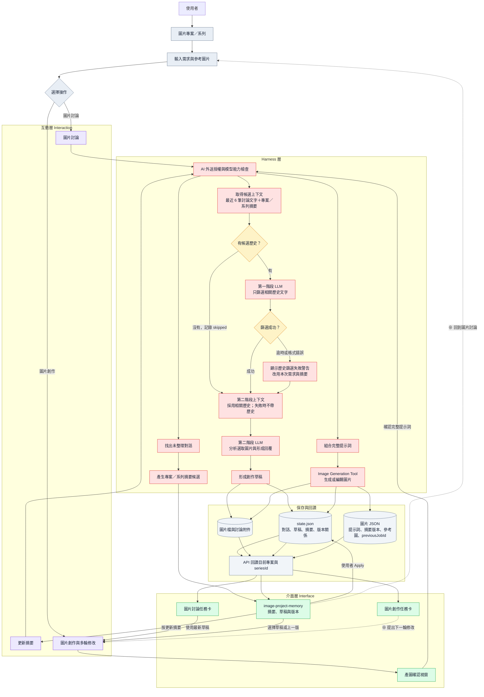
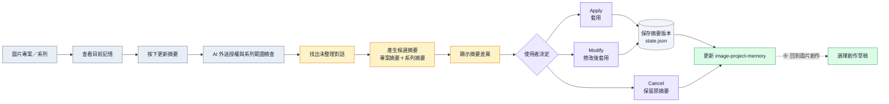
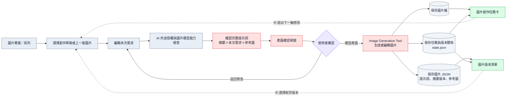

# 圖片專案記憶與連續創作流程

本文件記錄圖片專案記憶、圖片系列、摘要更新、跨專案複製與永久刪除的現行流程；最後一章列出仍待改善的部分。

## 零、圖片對話、圖片創作與記憶的跨層流程

本節提供兩種 Mermaid 視圖：

- 版本一：所有流程放在同一張圖，適合查看完整資料流與回到前端的關係。
- 版本二：拆成圖片討論、摘要更新、圖片創作三張圖，適合逐一理解每條流程。

### 版本一：所有流程



### 版本二：拆分為三個流程

#### 1. 圖片討論

```mermaid
flowchart LR
  A[圖片專案／系列]
  B[輸入需求]
  C[加入參考圖片]
  D[AI 外送授權與模型能力檢查]
  E[取得候選上下文<br/>最近 6 筆討論文字<br/>專案摘要＋系列摘要]
  E0{有候選歷史？}
  E1[第一階段 LLM<br/>篩選與目前需求相關的歷史文字]
  E2{篩選成功？}
  E3[組合第二階段上下文<br/>相關歷史（可為空）＋本次需求＋摘要]
  E4[不帶最近歷史<br/>顯示回退警告]
  F[第二階段 LLM<br/>分析選取圖片與形成回覆]
  G[形成創作草稿]
  H[(保存 state.json<br/>原始需求、回答、草稿)]
  I[(保存討論附件)]
  J[圖片討論任務卡]

  A --> B --> C --> D --> E --> E0
  E0 -->|有| E1 --> E2
  E0 -->|沒有，記錄 skipped| E3
  E2 -->|成功| E3 --> F --> G
  E2 -->|逾時或格式錯誤| E4 --> F
  G --> H
  G --> I
  H --> J
  I --> J
  J -.->|⊕ 繼續討論| B

  classDef common fill:#e8eef5,stroke:#64748b,color:#172033
  classDef discussion fill:#dbeafe,stroke:#2563eb,color:#172033
  classDef decision fill:#fef3c7,stroke:#d97706,color:#172033
  classDef storage fill:#f1f5f9,stroke:#64748b,color:#172033
  classDef output fill:#dcfce7,stroke:#16a34a,color:#172033

  class A,B,C,D common
  class E,E1,E3,E4,F,G discussion
  class E0,E2 decision
  class H,I storage
  class J output
```



#### 2. 摘要更新



#### 3. 圖片創作



### 圖中的兩種記憶

- 創作草稿：
  - 每一輪圖片討論完成後，由 LLM 額外整理。
  - 保存本輪 Agent 理解、參考圖片觀察、候選完整提示詞與來源附件。
  - 供後續選擇草稿與多輪修改使用，不會自動送出產圖。
- 專案摘要與系列摘要：
  - 專案摘要保存跨系列共用的風格、品牌、角色與限制。
  - 系列摘要保存目前圖片系列的主體、構圖、視角與版本決定。
  - 目前由使用者按「更新摘要」產生候選，檢查差異並套用後才成為有效摘要。
- 一般對話記憶：
  - 圖片討論不使用一般工作區的 `memory.summary`、`memory.confirmed` 或關鍵字取回內容。
  - 圖片工作區只使用同一圖片專案與目前系列的記憶，避免混入程式修改、文件查詢或其他圖片專案資料。

### 圖片討論的兩階段請求與追蹤點

1. 第一階段只讀取目前需求、專案摘要、系列摘要與同系列最近 6 筆討論的文字結果，不讀取或分析圖片內容。
2. 第一階段回傳與目前需求相關的任務 ID；後端保存候選 ID、採用 ID、理由、耗時、用量、狀態與錯誤資料於 `imageProjectChat.historySelection`，並以 `ai.image_history_selection` 顯示在執行工具紀錄中。
3. 第二階段只收到第一階段選出的歷史文字、本次需求、專案／系列摘要，以及使用者本次勾選的圖片；圖片內容只在這一階段分析。
4. 第一階段逾時或格式錯誤時，第二階段仍繼續，但不帶最近 6 筆歷史，只使用本次需求、專案摘要、系列摘要與選取圖片。任務卡顯示「歷史內容篩選失敗，已改用當前對話窗中的內容」。
5. 第一階段沒有候選歷史時直接記錄為 `skipped`，不發出不必要的模型請求。

### 從保存資料回到前端

- `runtime/assistant-state/state.json` 保存圖片專案、系列、討論任務、創作草稿、摘要版本、來源任務 ID 與圖片版本關係。
- 圖片檔保存於圖片輸出位置；圖片討論實際送出的附件也歸入目前系列，服務重啟後仍可預覽。
- 每個圖片版本的 JSON 保存實際提示詞、使用的專案與系列摘要版本、參考圖片、來源草稿及 `previousJobId`。
- 前端依目前圖片專案與 `seriesId` 回讀資料：
  - `#history` 顯示目前系列的圖片討論、圖片創作任務與版本。
  - `#image-project-memory` 顯示專案摘要、系列摘要、草稿、版本與未整理狀態。
  - 圖片討論卡顯示 Agent 理解與參考圖片觀察。
  - 圖片創作卡顯示 AI 回應、生成圖片與版本關係。
- 刪除圖片系列時，系列對話、摘要歷史、草稿、版本任務、圖片 JSON、PNG 與討論附件會一起永久刪除；稽核只保留 ID、時間與數量。

## 一、目前行為

- 圖片討論使用 `/api/image-project-chat`。
  - 第一則討論立即建立圖片系列，後端把 `seriesId` 寫入任務紀錄。
  - 先把目前系列最近 6 筆已完成討論的文字、專案摘要、系列摘要與本次需求交給第一階段 LLM 篩選，再把採用的歷史文字交給第二階段圖片理解 LLM。
  - 第一階段不分析圖片；第二階段才接收本次勾選的參考圖。
  - 第一階段逾時或格式錯誤時，不阻斷圖片討論；第二階段改用本次需求、專案摘要與系列摘要，並顯示明確回退警告。
  - 一般 `memory.summary`、`memory.confirmed` 與關鍵字取回不會加入。
  - `autoMemory` 固定為 `false`。
  - 每輪討論完成後，額外由 LLM 整理並自動保存一筆系列草稿。
  - 草稿保存 Agent 理解、參考圖片觀察與候選完整提示詞；不會自動產圖。
  - 對話卡片先顯示 Agent 理解與參考圖片觀察；候選完整提示詞只在產圖確認視窗中顯示與編輯。
  - 沒有收到使用者提到的參考圖片時，Agent 必須說明無法觀察，前端與後端都保留草稿並阻止產圖。
  - 討論或草稿整理失敗時，仍保存原始要求、失敗狀態與錯誤，候選提示詞留空。
  - 可在 `#question-editor` 貼入 PNG、JPEG 或 WebP 圖片討論；手動貼圖加上「最新系列圖」最多 5 張。
  - 最新系列圖預設勾選並標為「圖一」；貼入圖依實際送出順序標為「圖二」、「圖三」等。沒有最新系列圖或取消勾選時，貼入圖從「圖一」開始。
  - 貼入圖與最新系列圖都可在送出討論前取消；一旦按下送出，整個附件草稿區都會清空，未勾選附件不延續到下一輪。
  - 成功送出的附件會先保存到圖片專案與任務紀錄，服務重啟後仍可追溯；建立任務前被拒絕時不保存附件，但會把拒絕原因與清除數量寫入後台 audit。
  - 有參考圖時，只有目前模型端點已啟用圖片輸入才送出。未啟用時保留附件並顯示原因，不建立討論任務。
  - 實際送出的貼圖會保存到目前圖片系列；服務重啟後可在任務卡片預覽，刪除系列時一併永久刪除。
- 實際產圖使用 `/api/image-project-generation`。
  - 產圖前顯示專案摘要、系列摘要、本次要求、完整提示詞與上一版差異。
  - 使用者確認後才傳送完整提示詞；實際使用的摘要版本會寫入圖片 JSON。
  - 預設以目前系列最新版本作為修改基礎，可取消「最新圖作參考」。
- `previousJobId` 延續圖片內容；專案摘要與系列摘要保存文字記憶，兩者用途分開。

## 二、記憶與圖片階層

```text
圖片創作
└─ 圖片專案
   ├─ 專案共用摘要
   └─ 圖片系列
      ├─ 系列摘要
      ├─ 對話草稿
      ├─ v1
      └─ v2
```

- 圖片創作可包含多個圖片專案，一個圖片專案可包含多個圖片系列。
- 專案摘要保存跨系列共用的風格、角色、品牌與限制。
- 系列摘要保存單張圖片的主體、構圖、視角與版本決定。
- 每個系列只顯示一份目前有效摘要，舊摘要以版本歷史保存。
- 每個版本保存實際提示詞、圖片、來源摘要版本與上一版任務 ID。
- 每個對話草稿保存本輪原始要求、Agent 理解、討論結果、候選完整提示詞與錯誤狀態。
- 每個對話草稿也保存本輪實際使用的參考圖片 ID；這些紀錄可追查圖片理解與後續產圖的來源。
- 記憶保存於 `runtime/assistant-state/state.json`，圖片檔保存於既有圖片輸出位置。

## 三、建立、切換與命名圖片系列

- 圖片專案沒有系列時，第一則圖片討論會立即建立新的 `seriesId`。
- 第一則訊息與 AI 回覆直接歸入新系列，不必等第一次產圖。
- 系統額外呼叫一次 AI，依第一則需求產生最多約 20 字的系列名稱。
- 命名失敗時使用本機截取的暫時名稱；使用者可重新命名。
- 使用者手動命名後，後續摘要更新不得自動覆蓋名稱。
- LLM 偵測到「另一張圖」等語意時，只能提出建立新系列的建議。
- 使用者確認後，觸發判斷的訊息與 AI 回覆移到新系列，並保存轉移紀錄。
- 使用者取消時，訊息與目前選取系列保持不變。
- 選取系列後，自動以該系列最新版本作為修改基礎；舊版本只能預覽。

## 四、前端顯示與對話範圍

- `#image-project-memory` 放在 `#composer-panel` 內、`#question` 上方的 `#composer-context`。
- 一般工作區顯示原有對話記憶；圖片工作區改顯示圖片專案與系列記憶。
- 預設收合成一行：系列名稱、最新版本、30 字內摘要與「更新摘要」。
- 寬度不足時使用省略號；滑鼠靠近後沿用現有多行 tooltip 顯示完整內容。
- 展開後顯示專案摘要、系列樹、版本、系列摘要與一鍵複製。
- 系列樹也顯示每輪對話草稿；點擊可回到該輪卡片查看完整內容。
  - 對話卡片固定顯示 Agent 理解與參考圖片觀察，不以使用者原話取代 Agent 理解；候選完整提示詞移到產圖確認視窗。
- 圖片對話輸入區直接顯示本次會送出的圖片：最新圖片創作圖優先標為「圖一」，附件草稿圖接續編號；每張都有勾選狀態。`#image-discussion-references-title` 隱藏以節省垂直空間。
- 取消勾選只排除本次送出；按下送出後，已勾選與未勾選的附件草稿都會移除，不帶入下一輪。
- 圖片操作在建立任務前被拒絕時同樣清空附件草稿，並在 `audit.jsonl` 保存操作類型、圖片專案／系列／對話 ID、拒絕原因與清除數量。
- 草稿失敗時顯示「未產生候選提示詞」與錯誤，保留原始要求供 Codex 追查。
- 點擊系列列會選取系列；獨立箭頭只控制展開與收合。
- 目前系列沿用既有選取背景色，讓使用者知道後續輸入會寫入哪個系列。
- 選取系列 A 時，`#history` 只顯示系列 A 的對話、產圖任務與版本。

## 五、手動更新摘要

- 第一版只在使用者按「更新摘要」後整理，不自動更新。
- 預設整理自上次成功套用摘要後，屬於目前系列的所有新對話。
- LLM 同時產生「專案摘要候選」與「系列摘要候選」，並保留來源任務 ID。
- 提示視窗分別顯示原版、候選版與新增、修改、刪除差異。
- 專案候選與系列候選可各自選擇，也可一起處理。
- `Apply` 直接套用候選摘要；`Modify` 允許編輯候選內容後再套用。
- `Cancel` 維持原摘要，不推進該摘要的整理位置；下次仍會納入相同新對話。
- 套用摘要不會直接產圖；使用者仍須另外按「開始創作圖片」。
- 沒有新對話時停用「更新摘要」；有未整理內容時在收合列顯示狀態。

## 六、產圖、複製與參考圖片

- 「用最新草稿創作」預設帶入目前系列最新完成草稿；使用者明確按下後才開啟產圖確認。
- 產圖確認視窗可切換同系列較早的完成草稿，並可直接編輯本次完整提示詞；編輯不回寫草稿。
- 若選定草稿含圖片理解附件，確認視窗依圖片對話的相同順序與「圖一、圖二…」編號列出每張參考圖並預設勾選；使用者可逐張取消後再開始創作。
- 選定的參考圖以官方 Images edits 多圖請求送出。圖片 JSON 保存參考圖 ID、名稱、來源與是否為系列版本，方便追查。
- 直接圖片創作所使用的本輪附件會先保存到圖片專案並寫入 `imageCreation.references`；任務接受後清空附件草稿，因此下一輪不會再次自動使用相同附件。
- 產圖任務保存選用的草稿任務 ID，讓圖片、完整提示詞與討論來源可追查。
- 產圖前顯示專案摘要、系列摘要、Agent 理解、本次要求與完整提示詞，使用者確認後才按「產生圖片」。
- 產圖任務完成後，在同一張任務卡顯示 AI 回應與生成圖片；回應來源可追溯到本次討論草稿或直接產圖要求。
- 若本次要求提到參考圖但未選取實際參考圖片，保留討論草稿並顯示原因，不建立產圖任務。
- 專案摘要與上一個已套用的專案摘要版本比較；系列摘要與上一個已套用的系列摘要版本比較。
- 完整提示詞與目前系列上一個圖片版本的完整提示詞比較；v1 沒有前版時，全部視為新增內容。
- 新增內容使用藍色，刪除內容使用暗紅色；同時顯示 `+`、`−` 標記，不能只依顏色辨識。
- 修改內容拆成暗紅色的舊內容與藍色的新內容；沒有差異時顯示「無變更」。
- 使用者修改本次要求或完整提示詞時，差異預覽同步重新計算。
- 摘要與提示詞在送出前可見；一鍵複製放在展開內容中。
- 複製版本時包含來源專案共用設定、系列摘要、完整提示詞、圖片副本與來源資訊。
- 匯入另一圖片專案後建立新的系列，不沿用來源 `seriesId` 或版本關係。
- 來源共用設定會形成目的專案候選更新；衝突項目由使用者逐項選擇。
- 匯入圖片可點擊預覽，並預設作為產圖參考圖；使用者可在送出前取消。
- 取消參考圖只影響本次產圖，不刪除已匯入的圖片副本。
- 產圖紀錄標示是否實際送出參考圖片；送出前重新核對模型能力與 AI 外送授權。

## 七、永久刪除圖片系列

- 刪除只作用於圖片系列，不刪除圖片專案、專案共用摘要或其他系列。
- 永久刪除系列的對話、摘要及歷史、版本任務、PNG、JSON 與本機輸出檔。
- 永久刪除也會刪除該系列為圖片討論保存的貼圖附件。
- 正在產圖的系列禁止刪除，必須先完成或取消任務。
- 確認視窗顯示系列名稱、版本數、對話數與檔案數。
- 使用者必須輸入本次服務的 6 碼主機管理碼，再按「永久刪除」。
- 刪除目前系列後，自動選取最近更新的剩餘系列及其最新版本。
- 沒有剩餘系列時顯示「尚未建立圖片系列」。
- 跨專案匯入使用圖片副本，因此來源系列刪除後不影響目的專案。
- 稽核只保留系列 ID、刪除時間與數量，不保存已刪除內容或管理碼。

## 八、流程驗證與錯誤修正紀錄

本節依問題主題記錄圖片討論與圖片創作流程實際執行時觀測到的錯誤。每個主題分別說明：

- 問題位於「版本二：拆分為三個流程」的哪一張圖與哪一個節點。
- 實際任務、狀態與檔案中觀測到的證據。
- 修正方式與修正後驗證結果。

這些內容屬於流程驗證與錯誤修正紀錄，不是圖片專案或圖片系列的建立步驟。

### 8.1 主題一：圖片討論的模型分析逾時

#### 對應流程圖與發生位置

問題發生在檔案 `image/圖片討論mermaid.png` 的「圖片討論」流程，也就是本文件「版本二：拆分為三個流程」中的「1. 圖片討論」圖。對應節點是：

```text
輸入需求
→ 加入參考圖片
→ 檢查 AI 外送授權與圖片模型能力
→ 取得最近 6 筆候選討論文字、專案摘要＋系列摘要
→ 第一階段 LLM 篩選相關歷史文字
→ 組合第二階段上下文、本次需求與選取圖片
→ 第二階段圖片模型分析  ← 原始事件的逾時位置
→ 形成創作草稿
→ 保存 state.json、討論附件與圖片討論任務卡
```

在目前調整後的完整流程圖中，同一位置是 Harness 層的 `H2[第二階段 LLM：分析選取圖片與形成回覆]`。當時尚未加入第一階段歷史篩選，因此舊紀錄中的「組合最近 6 筆討論」直接連到圖片模型分析；新增的第一階段不會改變這起既有逾時事件的歸屬。它不是 `圖片創作mermaid.png` 的 Image Generation Tool，也不是 `摘要更新mermaid.png` 的「產生候選摘要」節點。

#### 實際觀測結果

以圖片專案 `cf2c0652d61` 的兩次相同圖片討論為例：

1. 「檢查 AI 外送授權與圖片模型能力」已通過。
2. 系統完成圖片、需求與上下文組合。
3. 流程進入「圖片模型分析」，呼叫 `gpt-5.6-luna`。
4. 第一次模型請求執行 30.264 秒後超過單次 30 秒限制。
5. 系統自動重試一次，第二次執行 30.002 秒後再次逾時。
6. 模型分析尚未完成，因此沒有走到 `finish_image_discussion`，也沒有建立候選完整提示詞。

該次任務保存為 `AI_TIMEOUT：模型回應逾時`，狀態為部分完成；參考圖片與原始需求仍保留，方便後續追查。這表示失敗發生在模型分析階段，而不是授權檢查、附件保存或草稿寫入階段。

#### 修正後驗證

修正後，同一圖片討論改為單次較長的模型請求期限，不再以兩次 30 秒請求重試。後續成功案例的模型分析耗時約 41.026 秒，完成後才執行 `finish_image_discussion`，並保存：

- Agent 對參考圖片的理解。
- 圖片內容與風格觀察。
- 候選完整提示詞 `imageProjectDraft.prompt`。
- 本輪使用的參考圖片與來源任務 ID。

因此目前的驗證結論是：原本的 30 秒單次限制確實會在「圖片模型分析」尚未完成前切斷請求；延長單次期限後，該節點可以完成，後續草稿保存流程也能正常執行。

目前流程另外加入第一階段歷史文字篩選。兩個階段各自保存狀態與耗時；若第一階段逾時或格式錯誤，任務不會在該處終止，而會保存錯誤後回退到本次需求與摘要，並繼續執行第二階段圖片分析。這使日後可直接判斷問題發生於「歷史篩選」或「圖片模型分析」。

### 8.2 主題二：選擇舊版本修改時發生版本號碰撞

#### 對應流程圖與發生位置

問題發生在本文件「版本二：拆分為三個流程」中的「3. 圖片創作」圖，主要對應以下流程：

```text
選擇創作草稿或上一版圖片
→ 編輯本次需求
→ 確認完整提示詞
→ 產圖確認視窗
→ 使用者確認
→ Image Generation Tool 生成或編輯圖片
→ 保存圖片檔  ← 主要失敗節點
→ 保存圖片 JSON
→ 保存任務與版本關係 state.json
```

直接對應的節點是 `I[(保存圖片檔)]`。由於圖片檔未能保存，後續 `J[(保存圖片 JSON)]`、`K[(保存任務與版本關係 state.json)]`、`L[圖片創作任務卡]` 與 `M[圖片版本清單]` 也無法形成一致的完成狀態。

在本文件的完整流程圖中，問題位於 `H7[Image Generation Tool 生成或編輯圖片]` 之後，寫入 `P2[(圖片檔與討論附件)]`、`P3[(圖片 JSON)]` 與 `P1[(state.json)]` 的保存階段。它不是圖片模型生成失敗，也不是圖片討論的 `H2[分析圖片與回覆]` 逾時。

#### 實際觀測結果

以圖片專案 `cf2c0652d61` 的最後一次修改為例：

1. 使用者選擇第 1 版圖片作為修改基礎。
2. 舊邏輯只使用「所選上一版版本號＋1」，因此把新任務計算為第 2 版。
3. 同一系列已經存在完成的第 2 版任務與對應的 `v2.png`、`v2.json`。
4. 圖片模型完成生成後，系統使用不可覆寫模式保存新的 `v2`。
5. 檔案已存在，檔案系統回傳 `EEXIST`，任務因此記錄為部分完成。
6. 原始例外被轉成通用訊息「圖片產生或保存失敗，請檢查服務設定」，前端無法判斷是版本碰撞。

因此這次失敗的真正原因是版本編號與既有輸出檔碰撞，不是參考圖片、模型權限、額度或提示詞錯誤。

#### 修正後驗證

- 開始圖片生成前，同時檢查執行階段圖片目錄與圖片專案輸出目錄。
- 若預計使用的 `vN.png` 已存在，自動遞增版本號，直到找到未使用的版本。
- 選擇較早版本作為修改基礎只決定圖片內容來源，不再直接決定下一個全域版本號。
- 發生例外時，將原始錯誤代碼與訊息保存於 `imageCreation.error`，保留後續診斷證據。
- 圖片創作流程與瀏覽器流程測試已通過，既有圖片不會被覆寫。

### 8.3 主題三：產圖確認視窗顯示的參考圖與本輪對話不一致

#### 對應流程圖與發生位置

問題同樣發生在本文件「版本二：拆分為三個流程」中的「3. 圖片創作」圖，但位置較早，主要對應以下流程：

```text
選擇創作草稿或上一版圖片
→ 編輯本次需求並加入本輪參考圖
→ 確認完整提示詞、摘要、本次需求與參考圖
→ 產圖確認視窗  ← 顯示錯誤的位置
→ 使用者確認
→ Image Generation Tool 生成或編輯圖片
```

本輪貼入圖片屬於 `C[編輯本次需求]` 的輸入資料；系統在 `E[確認完整提示詞 摘要＋本次需求＋參考圖]` 組合材料，並由 `F[產圖確認視窗]` 顯示。因此表面問題位於節點 `F`，資料選擇問題則位於 `C → E → F`。

在本文件的完整流程圖中，對應介面層的 `I3[產圖確認視窗]` 與 Harness 層的 `H6[組合完整提示詞]`。它不是「1. 圖片討論」中的 `C[加入參考圖片]`，因為本案例是在既有草稿與上一版圖片之上，於本次圖片創作要求重新加入參考材料。

#### 實際觀測結果

1. 使用者在本輪對話框加入並勾選兩張圖片：ML 圖示與流程圖。
2. 產圖確認視窗卻顯示圖片系列歷史中的三張同名圖片。
3. 前端錯誤地彙整整個系列的歷史附件與歷次產圖參考圖，沒有優先使用本輪對話框的選取結果。
4. 後端在已選擇圖片討論草稿時，也只接受草稿或系列既有附件，忽略本輪尚在對話草稿區的新圖片。
5. 因此前端看到的材料與使用者剛剛勾選的圖片不同，實際送出的參考圖片也可能偏離本次意圖。

#### 修正後驗證

- `#image-create-reference-list` 合併目前選定圖片討論草稿保存的參考圖與本輪對話框已勾選的新圖片，依圖片 ID 去除重複，並預設全部加入本次創作。
- 選擇舊草稿會保留該輪的 Agent 理解、候選提示詞與參考圖片；本輪新加入的圖片接續列出，不會被舊草稿蓋過。
- 上一版創作基礎圖標為「圖一」，其餘草稿與本輪附件依實際送出順序接續標為「圖二」、「圖三」等，與圖片對話使用相同編號規則。
- 後端可同時處理「舊草稿提示詞＋本輪新參考圖」，並驗證圖片確實屬於目前對話或目前圖片系列。
- 已使用瀏覽器流程測試模擬既有草稿參考圖加上本輪兩張新圖片，確認產圖視窗只合併這些直接材料，不再列出整個系列中與所選草稿無關的歷史圖片。

### 8.4 主題四：圖片轉提示詞耗盡模型輸出額度

#### 對應流程圖與發生位置

問題發生在檔案 `image/圖片討論mermaid.png` 的「圖片討論」流程，也就是本文件「版本二：拆分為三個流程」中的「1. 圖片討論」圖。對應流程為：

```text
輸入需求「將圖一轉為生成提詞」
→ 加入最新系列圖片（圖一）
→ 檢查 AI 外送授權與圖片模型能力
→ 第一階段 LLM 篩選最近 6 筆候選討論文字
→ 組合第二階段上下文、本次需求與選取圖片
→ 第二階段圖片模型分析  ← max_output_tokens 發生位置
→ finish_image_discussion  ← 尚未完成
→ 形成並保存候選完整提示詞  ← 尚未執行
```

在完整跨層流程圖中，錯誤位於 Harness 層的 `H2[第二階段 LLM：分析選取圖片與形成回覆]`。第一階段歷史文字篩選已成功，圖片外送授權、模型圖片能力與附件組合也已通過；錯誤不是圖片上傳數量限制、Image Generation Tool 產圖或摘要更新流程所造成。

#### 實際觀測結果

以圖片專案 `cf2c0652d61`、「新圖片系列」最後一則圖片討論為例：

1. 使用者只輸入「將圖一轉為生成提詞」。
2. 本輪實際送入一張最新系列圖片，尺寸為 `1181 × 1331`，大小為 `1,817,433 bytes`；沒有送入五張圖片。
3. 第一階段歷史篩選耗時 `3.361` 秒，使用 `971` 個輸入 token 與 `114` 個輸出 token，並選出一筆相關歷史對話。
4. 第二階段呼叫 `gpt-5.6-luna` 分析圖片，執行 `29.443` 秒後由 Responses API 回報 `incomplete_details.reason = max_output_tokens`。
5. 該次圖片分析沒有自動重試；任務中的兩次 AI request 分別是第一階段歷史篩選與第二階段圖片分析。
6. 原本所有圖片任務都被要求輸出圖片摘要、元素清單、逐元素座標與尺寸、相對位置、樹狀結構、完整 OCR、不確定事項，並同時填寫 `answer`、`steps`、`conclusions`、`agentUnderstanding`、`discussion` 與 `prompt`。對單純的「圖片轉提示詞」需求而言，這些重複且過重的輸出耗盡原先 `4096` 的輸出額度。
7. 因模型尚未完成 `finish_image_discussion` 工具呼叫，系統保存為部分完成，沒有建立 `imageProjectDraft.prompt`。

此錯誤表示模型的**輸出額度**用完，不表示圖片輸入或使用者文字超過上下文限制。圖片會增加輸入處理量，也可能使模型需要較多分析內容，但本次明確中斷原因仍是 `max_output_tokens`。

#### 修正方式

- 將實際設定、預設設定與範例設定的 `maxOutputTokens` 從 `4096` 調整為 `9000`；設定仍受既有 `16384` 上限及總上下文預算檢查約束。
- 圖片創作討論改用需求導向的分析規則。使用者要求把圖片轉成提示詞時，只整理與生成有關的主體、構圖、風格、色彩及必要文字，並輸出一份完整候選提示詞。
- 只有使用者明確要求精確版面解析時，才輸出逐元素座標、尺寸、樹狀結構或完整 OCR；一般文件圖片分析仍保留原本的完整七段格式。
- 要求 `finish_image_discussion` 各欄位各司其職，避免在 `answer`、`agentUnderstanding`、`discussion` 與 `prompt` 重複同一篇長文，並保持步驟與結論欄位精簡。
- Responses API 回報 incomplete 時，除了保存安全的 `incomplete_details.reason`，也保存該次回應提供的 input/output usage；任務層與 `ai.request` 追蹤點都能查看，不再把第一階段的 token 用量誤認為圖片分析用量。

#### 修正後驗證

- 單元測試確認 Responses incomplete 錯誤會同時保存 `max_output_tokens` 原因及 input/output token usage。
- 單元測試確認 `image-planning-chat` 使用精簡圖片規則，不會套用一般圖片分析的固定座標、樹狀結構與完整 OCR 格式。
- 圖片討論仍維持每次最多五張參考圖片；最新系列圖片若勾選也計入五張總數。提高輸出額度不會放寬圖片數量、外送授權或模型能力檢查。
- 服務必須重新啟動，新的 `maxOutputTokens: 9000` 才會載入；既有失敗任務保留原始錯誤紀錄，重新送出後的新任務才使用新設定。

## 九、圖片對話與圖片創作的資料輸入與產出

- 本章區分兩條不同流程：
  - **圖片對話**：由文字／圖片理解模型分析需求與參考圖，形成回答與候選完整提示詞，不生成圖片。
  - **圖片創作**：將已確認的完整提示詞與參考圖片送往 Image Generation Tool，取得並保存 PNG。
- `maxOutputTokens: 9000` 用於 Responses 文字／圖片理解模型的輸出額度，例如歷史篩選、圖片對話與摘要整理。
  - Image Generation Tool 回傳的是圖片資料，不使用這個 `maxOutputTokens` 值。
  - 圖片創作的提示詞長度限制為 `1–15000` 字。

### 9.1 圖片對話收到的資料

- 本次使用者需求：
  - 來源是圖片對話輸入框的文字。
  - 長度限制為 `1–4000` 字。
  - 例如：「將圖一轉為生成提詞」。
- 圖片專案資料：
  - 圖片專案 ID、名稱與資料夾名稱。
  - 目前圖片專案摘要。
  - 圖片專案的 AI 外送授權狀態。
- 圖片系列資料：
  - 系列 ID 與系列名稱。
  - 目前系列摘要。
- 第一階段歷史文字篩選資料：
  - 目前系列最近最多 6 筆圖片對話的文字紀錄。
  - 每筆候選只包含任務 ID、使用者需求、公開回答、結論、推論、未知事項與任務狀態。
  - 第一階段不直接分析圖片內容。
  - 篩選模型產生：
    - `selectedJobIds`：與本次需求有關的歷史任務 ID，最多 6 筆。
    - `reason`：選取或不選取的簡短理由。
  - 第一階段逾時或格式錯誤時：
    - 保存錯誤代碼、`incomplete_details` 與模型有提供的 usage。
    - 顯示「歷史內容篩選失敗，已改用當前對話窗中的內容」。
    - 第二階段仍使用本次需求、專案摘要與系列摘要繼續執行。
- 第二階段圖片分析資料：
  - 本次需求。
  - 圖片專案摘要。
  - 系列摘要。
  - 第一階段選出的歷史對話文字。
  - 使用者本輪勾選的附件草稿圖。
  - 使用者沒有取消時的最新系列圖片。
  - 每張圖片的 `IMAGE ID`、顯示名稱、寬度與高度。
  - 圖片二進位內容。
- 圖片數量限制：
  - 圖片對話一次最多送入 5 張圖片。
  - 最新系列圖片若有勾選，也計入 5 張總數。
  - 最新系列圖片預設勾選時，本輪最多再加入 4 張附件草稿圖。
  - 取消最新系列圖片後，本輪最多加入 5 張附件草稿圖。
- 送出前檢查：
  - 服務必須使用 real AI 模式。
  - 圖片專案必須允許 AI 外送。
  - 模型與端點必須啟用圖片理解能力。
  - 圖片必須屬於目前對話或目前圖片系列。

### 9.2 圖片對話要求模型產生的內容

- 所有圖片對話必須呼叫 `finish_image_discussion`，一次回傳：
  - `status`
    - `completed`：本輪討論已完成。
    - `needs_input`：仍需使用者補充。
    - `partial`：只完成部分內容。
  - `answer`
    - 直接顯示在任務卡上給使用者看的回答。
    - 說明模型對本次需求的處理結果或仍需補充的內容。
  - `steps`
    - 本輪採取的精簡處理步驟。
  - `conclusions`
    - 本輪已形成的精簡結論。
  - `facts`
    - 圖片創作討論固定使用空陣列，避免把視覺判讀當成已驗證文件事實。
  - `inferences`
    - 從圖片或需求推測，但不能視為已確認事實的內容。
  - `unknown`
    - 無法辨識、仍有歧義或需要使用者決定的事項。
  - `agentUnderstanding`
    - Agent 對本次創作要求的整理。
    - 後續在產圖確認視窗中作為需求理解材料。
  - `discussion`
    - 與本次創作直接相關的圖片觀察、構圖、風格、文字與調整說明。
  - `prompt`
    - 可直接交給圖片模型的候選完整提示詞。
    - 保存為 `imageProjectDraft.prompt`，不是專案摘要或系列摘要。
- 目前圖片提詞任務使用精簡輸出格式：
  - 分析與本次需求直接相關的主體。
  - 分析構圖與資訊層級。
  - 分析風格與材質。
  - 分析主要色彩。
  - 整理圖片中需要保留、修改或生成的必要文字。
  - 產生一份完整 `prompt`。
  - 避免在 `answer`、`agentUnderstanding`、`discussion` 與 `prompt` 重複同一篇長文。
  - 保持 `steps`、`conclusions`、`inferences` 與 `unknown` 精簡。
- 使用者明確要求精確版面分析時，才額外產生：
  - 圖片摘要。
  - 元素清單。
  - 座標與尺寸。
  - 相對位置。
  - 樹狀結構。
  - OCR 文字辨識。
  - 不確定事項。
- 非圖片創作專案的一般圖片分析仍保留完整七段格式：
  - 圖片摘要。
  - 元素清單。
  - 座標與尺寸。
  - 相對位置。
  - 樹狀結構。
  - OCR 文字辨識。
  - 不確定事項。

### 9.3 圖片對話保存的內容

- 任務基本資料：
  - 原始使用者需求。
  - 任務狀態、開始時間、完成時間與公開進度。
  - 圖片專案 ID 與系列 ID。
- 歷史篩選追蹤點：
  - 候選任務 ID。
  - 實際選取的任務 ID。
  - 選取理由。
  - 執行狀態、嘗試次數與耗時。
  - usage。
  - 失敗時的錯誤代碼、`incomplete_details` 與回退警告。
- 第二階段模型追蹤點：
  - AI provider、模型與協定。
  - 模型請求次數。
  - 成功回應的 input/output usage。
  - incomplete response 有提供 usage 時，同時保存到任務 AI 用量與失敗的 `ai.request`。
  - `incomplete_details.reason`，例如 `max_output_tokens`。
- 圖片討論結果：
  - `answer`。
  - `steps`。
  - `conclusions`。
  - `inferences`。
  - `unknown`。
- 候選圖片創作草稿 `imageProjectDraft`：
  - `request`：本輪原始需求。
  - `agentUnderstanding`：Agent 對需求的整理。
  - `discussion`：參考圖片與創作方向的討論。
  - `prompt`：候選完整提示詞。
  - `referenceImageIds`：本輪實際使用的參考圖片 ID。
  - `createdAt`：草稿建立時間。
- 參考圖片追溯資料：
  - 本輪實際使用的附件會保存到圖片專案與系列範圍，供任務卡、草稿及後續產圖確認視窗追溯。
  - 使用者按下送出後，對話輸入區中的附件草稿全部清除，不會自動帶到下一輪。
  - 建立任務前被授權或格式檢查拒絕時，也記錄拒絕原因並清除本輪附件草稿。
- 圖片對話不會產生：
  - PNG 圖片。
  - 圖片版本號。
  - 圖片版本 JSON。
  - `previousJobId` 版本關係。

### 9.4 圖片創作收到的資料

- 圖片專案與系列：
  - 圖片專案 ID、名稱與資料夾名稱。
  - 系列 ID 與系列名稱。
  - 專案摘要及其版本號。
  - 系列摘要及其版本號。
- 創作需求：
  - `currentRequest`：本次新增或修改要求。
  - `prompt`：在產圖確認視窗中已確認的完整提示詞。
  - 沒有明確傳入完整提示詞時，後端以專案摘要、系列摘要及本次要求組合提示詞。
- 選取的圖片討論草稿：
  - `draftJobId`。
  - 草稿的 `agentUnderstanding`。
  - 草稿的 `discussion`。
  - 草稿的候選完整提示詞 `imageProjectDraft.prompt`。
  - 草稿當時實際使用的參考圖片。
- 圖片材料：
  - 使用者在產圖確認視窗中保留勾選的參考圖。
  - 本輪新加入並勾選的附件圖。
  - 選取的上一版圖片。
  - 上一版圖片若尚未出現在參考圖清單，系統會自動加入圖片編輯請求。
  - 使用者選取的參考圖片最多 5 張。
  - 上一版圖片獨立於這 5 張選取清單；若清單尚未包含上一版，系統會再加入上一版，因此圖片 edits request 最多可能包含 5 張選取參考圖加 1 張上一版圖片。
- 上一版修改保護：
  - 選取上一版圖片時，系統加入最高優先的修改規則。
  - 上一版的主題、內容、文字、流程、編號、構圖、物件與資訊層級預設保留。
  - 只有本次新增要求明確指定的項目可以修改或移除。
  - 新參考圖只作為指定項目的參考，不能自行取代上一版主題。
- 圖片模型設定：
  - 使用者選取或系統預設的圖片模型。
  - 本次服務的 OpenAI API key。
  - 每次創作需要的 6 碼管理碼確認。

### 9.5 圖片創作送往 Image Generation Tool 的內容

- 沒有任何參考圖片，也沒有選取上一版圖片時：
  - 使用圖片 generations endpoint。
  - 送出圖片模型名稱。
  - 送出完整提示詞。
  - 指定輸出格式為 PNG。
- 有參考圖片或上一版圖片時：
  - 使用圖片 edits endpoint。
  - 送出圖片模型名稱。
  - 送出完整提示詞。
  - 依確認視窗的順序送出參考圖片。
  - 送出上一版圖片作為修改基礎。
  - 指定輸出格式為 PNG。
- Image Generation Tool 不會收到：
  - 未經第一階段選取的最近 6 筆歷史對話。
  - 未勾選的附件草稿圖。
  - 其他系列的圖片或摘要。
  - 一般程式專案的檔案與記憶。

### 9.6 圖片創作產生並保存的內容

- 圖片檔：
  - 模型回傳的 PNG。
  - 圖片寬度與高度。
  - 對話執行目錄中的系列版本圖片。
  - 圖片專案目錄中的可辨識輸出檔名副本。
- 圖片版本 JSON：
  - 圖片模型名稱。
  - 完整提示詞。
  - 本次要求。
  - 圖片專案與系列資訊。
  - 專案摘要、系列摘要及其版本號快照。
  - `draftJobId`。
  - `previousJobId`。
  - 版本號。
  - 參考圖片清單與來源任務 ID。
  - PNG 檔名、輸出檔名、寬度與高度。
  - 建立時間。
- `state.json` 任務紀錄：
  - 圖片創作任務 ID 與系列 ID。
  - 執行狀態、進度、開始時間及完成時間。
  - 圖片模型、版本與上一版關係。
  - 產圖提示詞與摘要快照。
  - 成功時的輸出檔資料。
  - 失敗時的錯誤代碼與安全錯誤訊息。
- 前端顯示資料：
  - 圖片創作任務卡。
  - 圖片預覽。
  - 系列版本編號。
  - 修改此張圖片與下載 PNG 操作。
  - 圖片版本清單與版本關係。
- 圖片創作不會重新產生：
  - `agentUnderstanding`。
  - `discussion`。
  - 圖片對話用的 `answer` 或 `steps`。
  - 圖片模型不會產生圖片對話的結構化 `conclusions`；後端只在成功時建立「已產生檔案」的任務結論，在失敗時建立可公開的未知事項與錯誤紀錄。
  - 專案摘要或系列摘要候選。
- 產圖任務會沿用選取草稿中已保存的理解與討論，並把這些內容作為任務卡回應來源；真正送往圖片模型的文字是產圖確認視窗中確認的完整 `prompt`。

### 9.7 兩條流程與摘要更新的關係

- 圖片對話完成後：
  - 產生可選用的 `imageProjectDraft.prompt`。
  - 不會自動修改專案摘要或系列摘要。
- 圖片創作完成後：
  - 產生新圖片版本與版本紀錄。
  - 不會自動修改專案摘要或系列摘要。
- 使用者按下「更新摘要」時：
  - 系統收集自上次套用摘要後新增的圖片對話與圖片創作任務。
  - 圖片對話提供原始需求與公開回答。
  - 圖片創作提供本次要求、任務結果結論與完整提示詞。
  - 摘要模型產生專案摘要候選與系列摘要候選。
  - 使用者可以分別套用、啟用編輯後修改，或取消保留原摘要。
- 下一輪圖片對話：
  - 只會取得目前已套用的專案摘要與系列摘要。
  - 尚未套用的摘要候選不會成為正式記憶。
- 下一輪圖片創作：
  - 產圖確認視窗顯示目前已套用的摘要、選取草稿、本次要求、上一版圖片與已勾選參考圖。
  - 使用者確認後才把完整提示詞及圖片材料送往 Image Generation Tool。

## 十、權限、限制與下一步

- 圖片專案建立時預設允許內容送往目前設定的 AI；每次送出仍須 real AI、有效 API key 與模型能力可用。
- 圖片專案的外送授權與一般文件專案分開；一般文件專案未授權不會使圖片討論在送出前立即結束。
- 若圖片專案明確標記為不允許外送，保留原始討論並回報授權錯誤，不宣稱摘要或草稿已更新。
- 圖片專案記憶不得混入一般程式修改、文件查詢或其他圖片專案資料。
- 已實作：
  - 圖片專案與系列摘要資料、摘要版本及來源任務 ID。
  - 第一則討論建立系列、AI 命名與手動重新命名。
  - `#image-project-memory`、系列切換、版本預覽及 `#history` 系列過濾。
  - 手動產生雙摘要候選、個別勾選、編輯、差異與套用。
  - 產圖前完整提示詞組合、藍色新增與暗紅色刪除差異。
  - 跨圖片專案複製圖片副本、摘要選擇及預設參考圖。
  - 管理碼永久刪除系列、圖片檔、JSON 與對話資料。
  - 圖片討論的最多五張參考圖、模型能力阻擋、系列附件保存與產圖前逐張取消。
  - 舊圖片版本及舊圖片討論在服務啟動時遷移至系列。
- 目前限制：
  - 「另一張圖」先以明確關鍵詞提示建立新系列，尚未改成獨立 LLM 語意分類。
  - 跨專案匯入目前以專案摘要、系列摘要兩項分別確認，尚未拆成每一個風格欄位。
  - 摘要維持手動更新；流程穩定後再評估自動整理。
  - 參考圖片只在目前圖片系列與選定草稿內重用；跨系列或跨專案仍須透過既有匯入流程。
